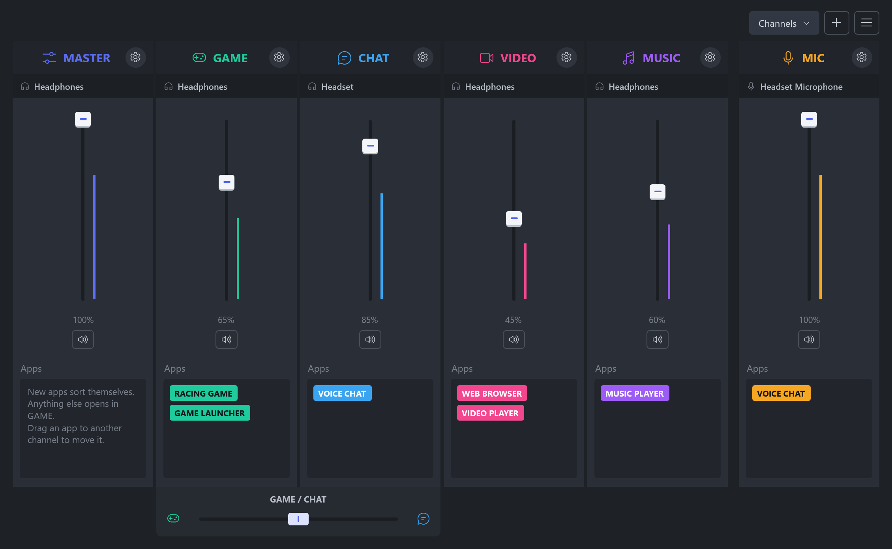
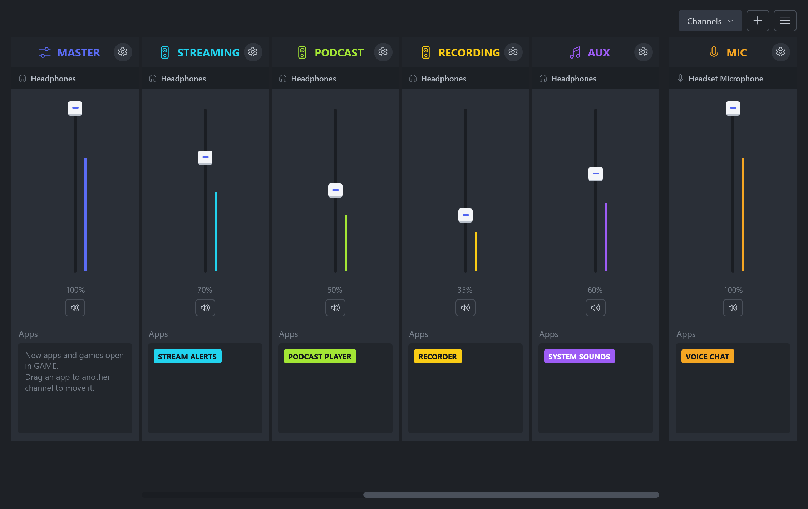
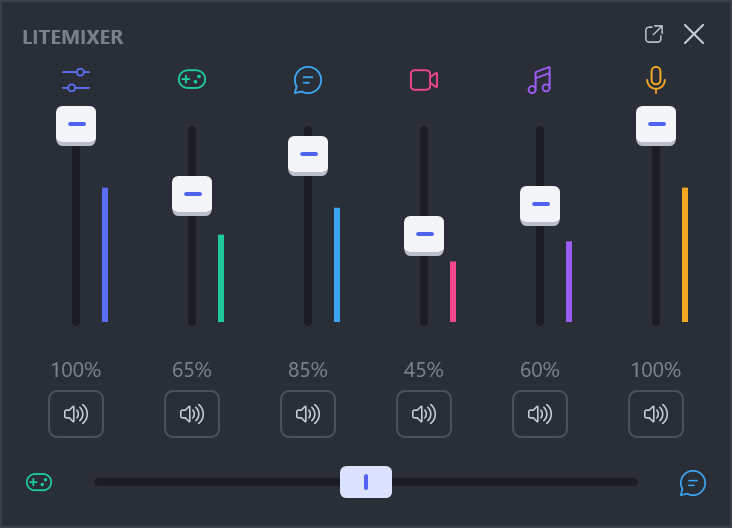
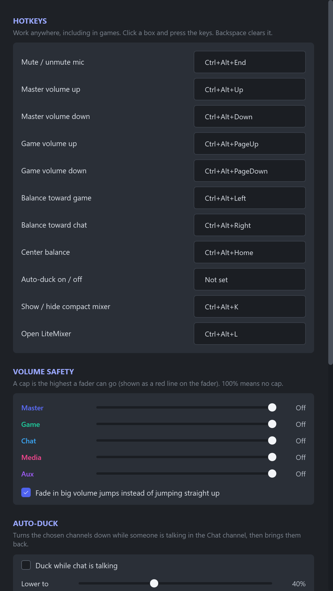

# LiteMixer

A small, light-weight audio mixer for Windows 10 and 11. Channels, per-app routing, game and chat balance, and hotkeys,
with no drivers and no account.

**[Download the latest version](https://github.com/vantageenterprises/litemixer/releases/latest/download/LiteMixer-Setup.exe)** ([all releases](https://github.com/vantageenterprises/litemixer/releases))



## What it does

- **Channels:** Master, Game, Chat, Media, Aux and Mic, plus as many named channels of your own as you like.
- **Per-app routing:** drag any app into a channel. Each channel has its own volume, mute and output device. New
  apps and games open in Game by default, and you can change that.
- **Game / Chat balance:** one slider between the two channels, in the mixer or on a hotkey.
- **Global hotkeys** for mic mute, volumes and balance that work while a game has focus.
- **Volume safety:** a cap per channel, and big increases fade in instead of jumping.
- **Auto-duck** (off by default): lowers Game and Media while someone talks in Chat.
- **Compact mixer:** a small always-on-top window with every fader, mute and the Game / Chat balance, so you can adjust
  levels over a game. Open it with Ctrl+Alt+K or from the menu; it remembers where you put it.
- **Per-app volume** inside a channel, **hidden apps**, and **profiles** for one-click setups.
- **Starts with Windows** in the tray and restores your devices, levels and assignments.

## Screenshots

Add as many named channels as you like, and scroll or jump between them:



| Compact mixer | Settings |
| --- | --- |
|  |  |

Apps and devices shown are sample names.

## How it works

LiteMixer installs no drivers. A channel is a group of apps: its volume scales each app's Windows session volume, and
its output device uses Windows' own per-app routing (the same setting as Settings > System > Sound > Volume mixer).

Because it doesn't sit in the audio path, it adds no latency and your sound keeps playing if it closes. It also means
there is no EQ, surround or mic processing.

Apps that choose their own device in their settings follow that choice. Set them to "Default" to let LiteMixer route
them. Volume and mute still work either way.

## Updates and privacy

LiteMixer asks GitHub once a day whether a newer release exists, and you can turn that off in Settings. The request
goes only to GitHub and includes nothing about you or your audio; as with any web request, GitHub sees your IP address.
Nothing installs until you agree. Before running an update, LiteMixer checks that Windows trusts the signature, that
the publisher is Vantage Enterprises, LLC, and that the version matches the release.

Settings live in `%APPDATA%\LiteMixer\settings.json`.

## Windows SmartScreen

Releases are signed, so Windows shows Vantage Enterprises, LLC as the publisher. SmartScreen can still warn about a
new download until it has built up reputation. If that happens, choose **More info**, check the publisher, then
**Run anyway**.

## License

LiteMixer is **free to use**, including at work and on stream. The source code is available to read, but this is not
an open source license.

**Selling, reselling, bundling, redistributing, or building LiteMixer into another product or service requires a
written agreement with us.** Contact [litemixer@vantageholdingsgroup.com](mailto:litemixer@vantageholdingsgroup.com).

See [LICENSE](LICENSE) for the full terms.

## Building

Needs the .NET 10 SDK and Visual Studio's C++ tools (for the native installer).

```powershell
dotnet build LiteMixer.csproj -c Release   # the app
./build-installer.ps1 -NoSign              # dist\LiteMixer_<version>.exe, unsigned
./install.ps1                              # dev install: framework-dependent, needs the .NET 10 Desktop Runtime
```

The installer is the native app in `installer/Setup`. It embeds a self-contained build, so the target PC needs nothing
installed; `installer/Pack` compresses the app into its payload, and the same exe without a payload is the uninstaller.

Checks that change nothing real:

- App: `LiteMixer.exe --ui-check <dir>` renders the windows offscreen and tests channel and updater logic.
  `--screenshots <dir>` renders the images in `docs/screenshots` from sample data.
- Installer: `--render <dir>` draws every screen, `--test-install <dir>` unpacks into that folder, and `--preview`
  opens the real window with simulated work.

### Releasing (maintainers)

```powershell
./release.ps1 -Version 1.1.0 -Notes "What changed, shown to users in the update prompt."
```

This builds, signs, tags, pushes and publishes the GitHub Release. Signing uses Azure Artifact Signing; copy
`signing/metadata.example.json` to `signing/metadata.json` (git-ignored) and run `az login`.

When .NET ships a security patch, bump the pinned `10.0.x` in `LiteMixer.csproj`, `build-installer.ps1` and
`installer/Setup/Setup.csproj`.
