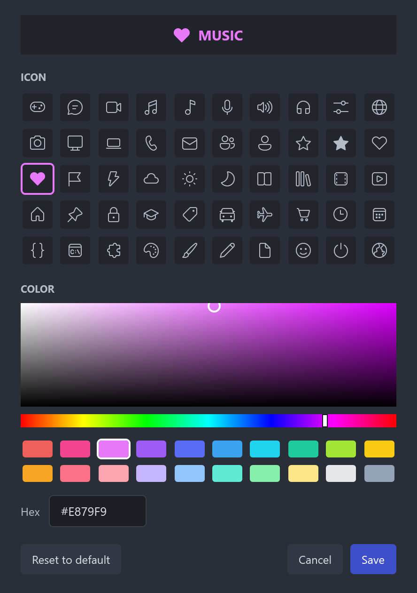

# LiteMixer

A small, light-weight audio mixer for Windows 10 and 11. Channels, per-app routing, game and chat balance, and hotkeys,
with no drivers and no account.

**[Download the latest version](https://github.com/vantageenterprises/litemixer/releases/latest/download/LiteMixer-Setup.exe)** ([all releases](https://github.com/vantageenterprises/litemixer/releases))


## What it does

- **Channels:** Master, Game, Chat, Video, Music and Mic, plus as many named channels of your own as you like.
- **Make it yours:** hold a channel's name and drag to rearrange it, and give any channel its own color and icon.
- **Per-app routing:** drag any app into a channel. Each channel has its own volume, mute and output device.
- **Automatic sorting:** the first time an app plays sound, games go to Game and common chat, music and video apps go
  to their channels. Anything else opens in your default channel. An app you move stays put, and you can turn sorting
  off. Apps using your microphone show on Mic and follow its device.
- **Game / Chat balance:** one slider between the two channels, in the mixer or on a hotkey.
- **Global hotkeys** for mic mute, volumes and balance that work while a game has focus.
- **Volume safety:** a cap per channel, and big increases fade in instead of jumping.
- **Auto-duck** (off by default): lowers Game and Video while someone talks in Chat.
- **Compact mixer:** a small always-on-top window with every fader, mute and the Game / Chat balance, so you can adjust
  levels over a game. Open it with Ctrl+Alt+K or from the menu; it remembers where you put it.
- **Per-app volume** inside a channel, **hidden apps**, and **profiles** for one-click setups.
- **Starts with Windows** in the tray and restores your devices, levels and assignments.
- **Install it where you like:** choose the folder during setup. Updates stay in that folder.
- **Stream mix** (off by default): a second set of levels for streaming and recording. See
  [Streaming and recording](#streaming-and-recording).

## Screenshots

Add as many named channels as you like, drag them into any order, and scroll or jump between them:


| Color and icon | Compact mixer | Settings |
| --- | --- | --- |
|  |  |  |

Apps and devices shown are sample names.

## Streaming and recording

The stream mix gives your audience their own levels. You can keep a game loud in your headset and quiet on stream, or
play music on stream while it's muted for you. Your headset stays exactly as your faders have it.

It works with OBS Studio, Streamlabs Desktop, XSplit and anything else that records from an audio input. Platforms like
Twitch and YouTube get their audio from those apps, so there's nothing to set up on their side.

**Setup**

1. Install a virtual cable. [VB-Cable](https://vb-audio.com/Cable/) is a free download from VB-Audio. It's a separate
   product with its own driver and terms, and LiteMixer doesn't install it for you. Restart your PC afterwards.
2. In LiteMixer, open **Settings > Streaming and recording** and turn on **Send a stream mix**. Choose the cable under
   **Send to**, usually called **CABLE Input**.
3. Each channel on the main mixer now has two faders. The one under the headphones is what you hear. The one under your
   streaming app's icon is what your stream gets, with its own mute button underneath. This includes every channel you've
   added, as many as you like. Master and Mic keep one fader.
4. In your streaming app, add an audio input source and choose the other end of the cable, usually called
   **CABLE Output**. In OBS that's **Sources > + > Audio Input Capture**.
5. Turn off your streaming app's **Desktop Audio**, or your audience hears everything twice.

To record, use the same setup. The stream mix goes to whatever your app is capturing, so a recording gets the same levels.

**Good to know**

- **Your mic isn't in the stream mix.** Add it in your streaming app as usual, so you keep its filters and its own track.
- **Two mute buttons.** Muting a channel on your side, or turning that fader to zero, only silences it for you. It still
  reaches the stream. To keep a channel off the stream, use the mute button on the stream side.
- **Devices you listen on can't be used.** The stream mix plays at its own levels, so LiteMixer refuses to send it to
  your headset or speakers.
- **Streaming apps are left out of the mix,** so their own sound can't feed back into your stream. Windows system sounds
  aren't included either.
- **Audio sync:** the mix arrives about 140 ms behind your screen, measured through VB-Cable. If you notice it, delay
  your video source to match, since most streaming apps can't move audio earlier.
- **Windows version:** this needs Windows 10 version 2004 or newer.
- **Muted channels while the stream mix is on:** Windows captures nothing from a truly muted app, so a channel that's
  silent for you sits at -100 dB instead, far below hearing. Windows' Volume mixer shows it as 0% rather than muted.
- **OBS's Application Audio Capture** is a different way to capture apps, and it needs no cable. It follows your
  LiteMixer faders and mutes rather than having its own levels, so turning a channel down also lowers it on stream.

## How it works

LiteMixer installs no drivers. A channel is a group of apps: its volume scales each app's Windows session volume, and
its output device uses Windows' own per-app routing (the same setting as Settings > System > Sound > Volume mixer).

Because it doesn't sit in the audio path, it adds no latency and your sound keeps playing if it closes. It also means
there is no EQ, surround or mic processing. The stream mix works from a copy of each app's audio, so what you hear still
doesn't pass through LiteMixer, though the stream mix itself stops if LiteMixer closes.

Apps that choose their own device in their settings follow that choice. Set them to "Default" to let LiteMixer route
them. Volume and mute still work either way.

## Updates and privacy

LiteMixer asks GitHub once a day whether a newer release exists, and you can turn that off in Settings. The request
goes only to GitHub and includes nothing about you or your audio; as with any web request, GitHub sees your IP address.
A new version shows what's in it in a small window, held back during fullscreen games, and nothing installs until you
agree. Before running an update, LiteMixer checks that Windows trusts the signature, that
the publisher is Vantage Enterprises, LLC, and that the version matches the release.

Settings live in `%APPDATA%\LiteMixer\settings.json`.

## Windows SmartScreen

Releases are signed, so Windows shows Vantage Enterprises, LLC as the publisher. SmartScreen can still warn about a
new download until it has built up reputation. If that happens, choose **More info**, check the publisher, then
**Run anyway**.

## License

LiteMixer is **free to use**, including at work and on stream. The source code is available to read, but this is not
an open source license.

**Selling, reselling, bundling, redistributing, or building LiteMixer into another product or service requires a
written agreement with us.** Contact [litemixer@vantageholdingsgroup.com](mailto:litemixer@vantageholdingsgroup.com).

See [LICENSE](LICENSE) for the full terms.

## Building

Needs the .NET 10 SDK and Visual Studio's C++ tools (for the native installer).

```powershell
dotnet build LiteMixer.csproj -c Release   # the app
./build-installer.ps1 -NoSign              # dist\LiteMixer_<version>.exe, unsigned
./install.ps1                              # dev install: framework-dependent, needs the .NET 10 Desktop Runtime
```

The installer is the native app in `installer/Setup`. It embeds a self-contained build, so the target PC needs nothing
installed; `installer/Pack` compresses the app into its payload, and the same exe without a payload is the uninstaller.

Checks that change nothing real:

- App: `LiteMixer.exe --ui-check <dir>` renders the windows offscreen and tests channel and updater logic.
  `--stream-check <file>` tests the stream mix with real capture, using a silent tone in a throwaway process.
  `--screenshots <dir>` renders the images in `docs/screenshots` from sample data.
- Installer: `--render <dir>` draws every screen, `--test-install <dir>` unpacks into that folder,
  `--check-location <dir>` tests choosing an install folder inside that folder, and `--preview` opens the real window
  with simulated work.

### Releasing (maintainers)

```powershell
./release.ps1 -Version 1.1.0 -Notes "What changed, shown to users in the update prompt."
```

This builds, signs, tags, pushes and publishes the GitHub Release. Signing uses Azure Artifact Signing; copy
`signing/metadata.example.json` to `signing/metadata.json` (git-ignored) and run `az login`.

When .NET ships a security patch, bump the pinned `10.0.x` in `LiteMixer.csproj`, `build-installer.ps1` and
`installer/Setup/Setup.csproj`.
